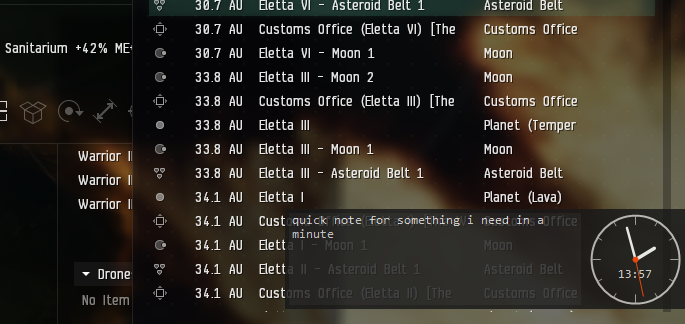

# Note-Clock

A tiny, always-on-top desktop widget for Windows: an analog clock with a small note pad next to it.
It stays on top of all other windows, has no frame or title bar, and keeps out of the taskbar and Alt+Tab,
so it is as unobtrusive as possible.

some more [BLAH-BLAH about it on my website](https://0x8.in.th/18658)

**It's not pretty, but it does exactly one job and stays out of the way. That's all I want from a desktop tool.**



*Note-Clock in the lower right corner, semi-transparent on top of a crowded window: a quick note on the left,
the clock on the right.*

Layout:

```
+------------------------------------+----------+
|  note area (300 x 100)             |  analog  |
|  type anything here                |  clock   |
|                                    |  13:27   |
+------------------------------------+----------+
```

## Features

- **Analog clock** (100 x 100 px) with a digital time in the lower part of the face.
  - Not focused: shows `HH:mm`, the hands are drawn over it.
  - Focused: shows `HH:mm:ss`, drawn on top of the hands.
- **Note pad** (300 x 100 px) on the left; just click and type.
- **Move** the window by dragging it with the **right** mouse button (works anywhere, including the note area).
- **Poor man's click-through**: double-click the clock face and the window disappears for 10 seconds, so you can
  click whatever is behind it. It comes back without stealing keyboard focus.
- **Transparency** from 100% down to 20%, set from the tray icon menu.
- **Tray icon** menu: Transparency, Reset position, Exit. Double-click the tray icon to bring the window back
  immediately and focus the note.
- **Persistence**: position, transparency and note text are saved to `NoteClock.json` next to the exe and restored
  on start. If the saved position is off every screen (e.g. a monitor was unplugged), it falls back to a default spot.

## Usage

Download the Release file, put it anywhere you want, Run `NoteClock.exe`.
To start it with Windows, put a shortcut to it in the folder that opens with `Win+R` → `shell:startup`.

## Build yourself

No SDK or extra tools needed; it uses the C# compiler that ships with Windows (.NET Framework 4.x):

```
build.bat
```

This produces `NoteClock.exe` from `NoteClock.cs`.

## Files

| File             | Purpose                                      |
|------------------|----------------------------------------------|
| `NoteClock.cs`   | The whole application (WinForms, ~350 lines) |
| `build.bat`      | Compiles `NoteClock.exe`                     |
| `NoteClock.exe`  | The prebuilt app                             |
| `NoteClock.json` | Saved position, transparency and note        |
| `docs/`          | Screenshot used in this README               |

## License

MIT [LICENSE](LICENSE).
